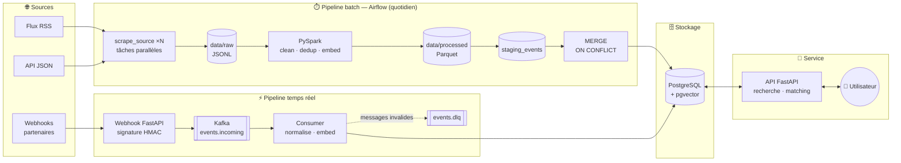
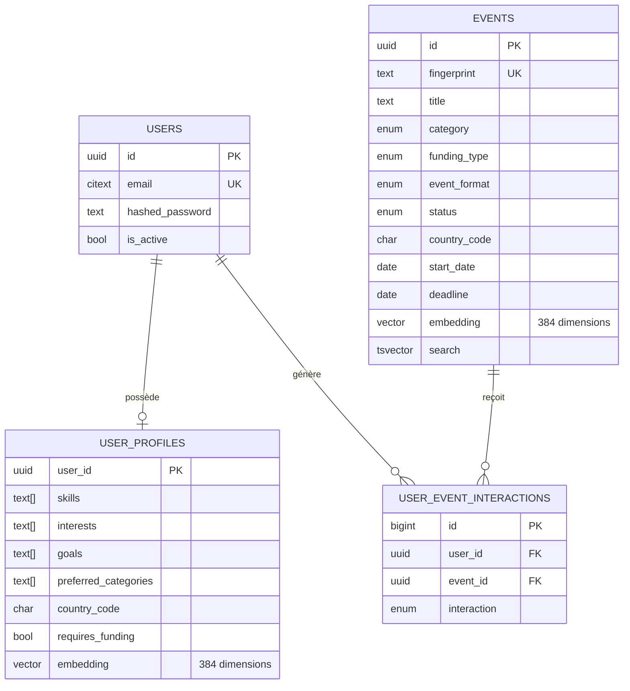

<div align="center">

# 🌍 EventPro

### Plateforme intelligente d'agrégation et de recommandation d'événements professionnels et académiques

*Conférences, hackathons, bourses, fellowships, subventions… financés ou non.*
*Pensée pour l'Afrique, ouverte au monde.*

<br/>


<br/><br/>


</div>

---

## 📑 Sommaire

- [Le problème](#-le-problème)
- [La solution](#-la-solution)
- [Fonctionnalités](#-fonctionnalités)
- [Stack technique](#-stack-technique)
- [Architecture](#-architecture)
- [Structure du projet](#-structure-du-projet)
- [Démarrage rapide](#-démarrage-rapide)
- [Utilisation](#-utilisation)
- [Le moteur de recommandation](#-le-moteur-de-recommandation)
- [Qualité des données](#-qualité-des-données)
- [Modèle de données](#-modèle-de-données)
- [Tests](#-tests)
- [Feuille de route](#-feuille-de-route)
- [Auteur](#-auteur)

---

## 🎯 Le problème

Les opportunités qui peuvent changer une carrière (une bourse de master, un hackathon financé,
une conférence internationale, un fellowship) sont **dispersées** sur des dizaines de sites,
blogs et newsletters. Elles sont publiées dans des formats hétérogènes, souvent en double, et
il est difficile de savoir lesquelles sont **financées**, **encore ouvertes** et
**pertinentes pour soi**.

Résultat : beaucoup d'étudiants et de jeunes professionnels, en particulier en Afrique,
passent à côté d'opportunités faites pour eux.

## 💡 La solution

**EventPro** collecte automatiquement ces événements, les **nettoie**, les **dédoublonne**, les
**classe** (type, financement, format, pays), puis les **recommande** à chaque utilisateur
selon son profil : compétences, objectifs, centres d'intérêt et localisation.

La recommandation est **sémantique** : elle compare le *sens* du profil et des événements (via
des embeddings multilingues FR/EN), pas seulement des mots-clés. Chaque suggestion est
**expliquée** (« Entièrement financé », « Se déroule dans votre pays », « Clôture dans 3 jours »).

---

## ✨ Fonctionnalités

| | Fonctionnalité | Détail |
|---|---|---|
| 🕷️ | **Collecte multi-sources** | Flux RSS et API JSON, déclarés dans un simple fichier YAML |
| ⏱️ | **Pipeline batch quotidien** | Orchestré par Airflow, traité par PySpark |
| ⚡ | **Ingestion temps réel** | Webhooks signés (HMAC) → Kafka → base en quelques secondes |
| 🧹 | **Nettoyage & normalisation** | HTML, dates FR/EN (« 1er février 2027 », « 12 au 15 mars »), URLs |
| 🔁 | **Déduplication cross-sources** | Par URL canonique puis par empreinte (titre + date + lieu) |
| 🏷️ | **Classification automatique** | Conférence, hackathon, bourse… · Financé / partiellement / non financé |
| 🌍 | **Géolocalisation Afrique** | 54 pays africains + villes clés (Lagos, Kigali, Dakar, Douala…) |
| 🧠 | **Recherche sémantique** | « bourse master IA » trouve aussi « AI scholarship » |
| 🎯 | **Recommandation personnalisée** | Similarité cosinus + règles métier, résultats expliqués |
| 🔐 | **Authentification** | JWT, mots de passe hachés en Argon2 |
| 🗓️ | **Expiration automatique** | Les opportunités dont la date limite est passée sont masquées |

---

## 🛠️ Stack technique

<table>
<tr>
<td align="center" width="140"><br/><b>Python 3.11</b><br/><sub>Langage, typage strict</sub></td>
<td align="center" width="140"><br/><b>FastAPI</b><br/><sub>API REST async</sub></td>
<td align="center" width="140"><br/><b>PostgreSQL + pgvector</b><br/><sub>Données + vecteurs (HNSW)</sub></td>
<td align="center" width="140"><br/><b>Apache Airflow 3</b><br/><sub>Orchestration batch</sub></td>
</tr>
<tr>
<td align="center"><br/><b>PySpark</b><br/><sub>Nettoyage & dédup à l'échelle</sub></td>
<td align="center"><br/><b>Kafka (Redpanda)</b><br/><sub>Streaming temps réel</sub></td>
<td align="center"><br/><b>Sentence-Transformers</b><br/><sub>Embeddings multilingues</sub></td>
<td align="center"><br/><b>Docker Compose</b><br/><sub>Stack locale complète</sub></td>
</tr>
</table>

| Couche | Technologies |
|---|---|
| **API** | FastAPI · Pydantic v2 · SQLAlchemy 2.0 (async) · asyncpg · PyJWT · pwdlib (Argon2) |
| **Base de données** | PostgreSQL 16 · pgvector 0.8 (index HNSW, distance cosinus) · pg_trgm · full-text search |
| **Batch** | Apache Airflow 3 (TaskFlow, dynamic task mapping) · PySpark 3.5 (pandas UDF, Arrow) |
| **Streaming** | Redpanda (compatible Kafka) · aiokafka · psycopg 3 (pool async) |
| **IA / NLP** | `paraphrase-multilingual-MiniLM-L12-v2` (384 dimensions, FR/EN) · PyTorch CPU |
| **Collecte** | httpx · feedparser · PyYAML |
| **Infra** | Docker · Docker Compose (profils) · healthchecks |
| **Qualité** | pytest · ruff · mypy (strict) |

---

## 🏗️ Architecture



**Point clé :** toute la logique métier (classification, parsing des dates, détection des pays,
empreinte de déduplication, texte d'embedding) est écrite **une seule fois** dans le package
partagé [`common/`](common/). Spark, le consumer temps réel et l'API l'utilisent tous. Un même
événement reçu par le batch **et** par le streaming produit donc la même empreinte et donne
**une seule ligne** en base.

---

## 📁 Structure du projet

```
EVENT/
├── 🐳 docker-compose.yml          Postgres/pgvector · Airflow 3 · API (+ profil streaming)
├── ⚙️  .env.example                Variables d'environnement (à copier en .env)
│
├── 📦 common/                     Package partagé eventpro_common
│   └── src/eventpro_common/
│       ├── taxonomy.py            Enums + classifieurs catégorie / financement / format
│       ├── text.py                Nettoyage HTML, URL canonique, empreinte sha256
│       ├── dates.py               Dates ISO / EN / FR et plages de dates
│       ├── geo.py                 54 pays africains + hubs mondiaux + villes
│       ├── embeddings.py          Modèle multilingue + templates de texte
│       ├── schemas.py             Contrats RawEvent / NormalizedEvent
│       └── normalization.py       RawEvent → NormalizedEvent (fonction pure)
│
├── 🗄️  database/
│   └── init.sql                   Schéma complet (tables, enums, index HNSW, fonctions)
│
├── 🌀 airflow/
│   ├── Dockerfile                 Airflow 3 + Java 17 + PySpark + PyTorch CPU
│   ├── dags/
│   │   ├── events_batch_pipeline.py
│   │   └── sql/                   merge_staging_events.sql · expire_events.sql
│   └── include/
│       ├── sources.yaml           Déclaration des sources de collecte
│       └── scrapers/              base · rss · json_api · registry · writer
│
├── ⚡ spark/jobs/
│   ├── clean_events.py            Normalisation + déduplication + embeddings
│   ├── load_events.py             Parquet → PostgreSQL (JDBC)
│   └── spark_utils.py
│
├── 📡 streaming/
│   ├── app/
│   │   ├── webhook.py             Réception signée → Kafka
│   │   ├── consumer.py            Kafka → normalisation → embedding → upsert
│   │   ├── repository.py
│   │   └── config.py
│   └── scripts/send_sample_event.py
│
├── 🚀 backend/
│   ├── app/
│   │   ├── main.py                Application + chargement du modèle au démarrage
│   │   ├── core/                  Configuration · sécurité (JWT, Argon2)
│   │   ├── db/                    Moteur async + codec pgvector
│   │   ├── models/                Modèles SQLAlchemy 2.0 typés
│   │   ├── schemas/               Schémas Pydantic v2
│   │   ├── repositories/          Accès données (plein texte, vecteurs)
│   │   ├── services/              Embeddings · scoring · recommandation
│   │   └── api/v1/endpoints/      auth · users · events · recommendations · health
│   └── tests/
│
└── 💾 data/
    ├── raw/                       <source>/batch_date=AAAA-MM-JJ/events.jsonl
    └── processed/                 events/ et rejected/ par date de batch
```

---

## 🚀 Démarrage rapide

### Prérequis

- 🐳 [Docker Desktop](https://www.docker.com/products/docker-desktop/) avec **au moins 8 Go de RAM** alloués
- 🐙 Git

### Installation

```bash
# 1. Cloner le dépôt
git clone https://github.com/BeaElie237/event_pro.git
cd event_pro

# 2. Configurer l'environnement
cp .env.example .env
# ➜ remplacer toutes les valeurs "change-me-*" dans .env

# 3. Lancer la stack principale (PostgreSQL + Airflow + API)
docker compose up -d --build

# 4. (Optionnel) Ajouter le streaming temps réel (Kafka + webhook + consumer)
docker compose --profile streaming up -d --build
```

> ⏳ Au premier démarrage, chaque service télécharge le modèle d'embedding (~470 Mo), puis le
> garde en cache dans un volume Docker. Les démarrages suivants sont rapides.

### Services disponibles

| Service | URL | Description |
|---|---|---|
| 📘 **API — Swagger** | http://localhost:8000/docs | Documentation interactive de l'API |
| 🌀 **Airflow** | http://localhost:8080 | Supervision des pipelines (identifiants dans `.env`) |
| 📡 **Webhook** | http://localhost:8001/webhooks/events | Ingestion temps réel |
| 🗄️ **PostgreSQL** | `localhost:5432` | Base applicative |

---

## 📖 Utilisation

### 1️⃣ Lancer la collecte batch

Dans l'interface Airflow, activez le DAG **`events_batch_pipeline`**, puis cliquez sur ▶.
Ou en ligne de commande :

```bash
docker compose exec airflow-scheduler airflow dags unpause events_batch_pipeline
docker compose exec airflow-scheduler airflow dags trigger events_batch_pipeline
```

Les étapes du DAG :

```
resolve_batch_date ─► list_sources ─► scrape_source (×N en parallèle)
        ─► check_raw_data ─► spark_clean_events ─► spark_load_staging
        ─► merge_into_events ─► expire_past_events
```

### 2️⃣ Envoyer un événement en temps réel

```bash
python streaming/scripts/send_sample_event.py --secret "<WEBHOOK_SECRET>"
# ➜ 202 {"accepted": 1}   — l'événement est en base quelques secondes après
```

### 3️⃣ Utiliser l'API

```bash
# Créer un compte
curl -X POST localhost:8000/api/v1/auth/register \
  -H "Content-Type: application/json" \
  -d '{"email":"awa@example.com","password":"Sup3rSecret!","full_name":"Awa"}'

# Obtenir un token
curl -X POST localhost:8000/api/v1/auth/token \
  -d "username=awa@example.com&password=Sup3rSecret!"

# Renseigner son profil (l'embedding est calculé automatiquement)
curl -X PUT localhost:8000/api/v1/users/me/profile \
  -H "Authorization: Bearer <TOKEN>" -H "Content-Type: application/json" \
  -d '{
        "headline": "Data scientist junior",
        "skills": ["python", "machine learning", "NLP"],
        "interests": ["IA pour la santé", "agritech"],
        "goals": ["trouver un master financé"],
        "preferred_categories": ["scholarship", "hackathon"],
        "country_code": "CM",
        "requires_funding": true
      }'

# Recevoir ses recommandations personnalisées
curl "localhost:8000/api/v1/recommendations/me?limit=10&africa_only=true" \
  -H "Authorization: Bearer <TOKEN>"
```

### 🔌 Endpoints

| Méthode | Route | Description | Auth |
|---|---|---|:---:|
| `GET` | `/health` · `/health/ready` | Liveness / readiness (BDD + modèle) | — |
| `POST` | `/api/v1/auth/register` | Création de compte | — |
| `POST` | `/api/v1/auth/token` | Connexion (OAuth2 password) | — |
| `GET` | `/api/v1/users/me` | Utilisateur courant | 🔐 |
| `GET` `PUT` | `/api/v1/users/me/profile` | Lire / enregistrer son profil | 🔐 |
| `GET` | `/api/v1/events` | Liste filtrée + recherche plein texte (`q=`) | — |
| `GET` | `/api/v1/events/search` | Recherche **sémantique** en langage naturel | — |
| `GET` | `/api/v1/events/{id}` | Détail d'un événement | — |
| `GET` | `/api/v1/recommendations/me` | Recommandations personnalisées | 🔐 |
| `POST` | `/api/v1/recommendations` | Matching pour un profil envoyé directement (sans compte) | — |

**Filtres disponibles** : `categories`, `funding_types`, `formats`, `country_code`, `africa_only`,
`starts_after`, `deadline_before`, `include_expired`.

<details>
<summary><b>📄 Exemple de réponse de recommandation</b></summary>

```json
{
  "items": [
    {
      "event": {
        "title": "Pan-African AI Hackathon — Fully Funded",
        "category": "hackathon",
        "funding_type": "fully_funded",
        "city": "Kigali",
        "country_name": "Rwanda",
        "deadline": "2026-11-19"
      },
      "score": 0.8712,
      "breakdown": {
        "semantic": 0.6431,
        "location": 0.7,
        "category": 1.0,
        "funding": 1.0,
        "urgency": 0.3333
      },
      "reasons": [
        "Très proche de votre profil",
        "Type recherché : hackathon",
        "Entièrement financé",
        "Sur votre continent"
      ]
    }
  ],
  "model": "sentence-transformers/paraphrase-multilingual-MiniLM-L12-v2",
  "generated_at": "2026-10-30T15:00:00Z"
}
```
</details>

---

## 🧠 Le moteur de recommandation

La recommandation se fait en **deux étapes** :

### Étape 1 — Récupération vectorielle (pgvector)

Le profil de l'utilisateur est transformé en texte, puis en **vecteur de 384 dimensions** par
un modèle multilingue. PostgreSQL renvoie les **200 événements actifs les plus proches** en
distance cosinus (opérateur `<=>`), grâce à un index **HNSW**. L'option `iterative_scan` de
pgvector 0.8 garantit qu'il reste assez de résultats même avec beaucoup de filtres.

### Étape 2 — Re-classement explicable

Chaque candidat reçoit un score hybride, calculé dans
[`scoring.py`](backend/app/services/scoring.py) :

| Signal | Poids | Règle |
|---|:---:|---|
| 🧠 **Sémantique** | **70 %** | Similarité cosinus entre le profil et l'événement |
| 📍 **Localisation** | 10 % | En ligne ou même pays = 1 · hybride = 0,8 · même continent = 0,7 |
| 🏷️ **Catégorie** | 10 % | Correspond aux types recherchés = 1 |
| 💰 **Financement** | 7 % | Si financement requis : complet = 1 · partiel = 0,6 |
| ⏰ **Urgence** | 3 % | Bonus si la date limite tombe dans les 30 prochains jours |

Les poids sont configurables, et le code vérifie que leur somme vaut 1.

---

## 🧹 Qualité des données

### Normalisation

| Entrée brute | Résultat |
|---|---|
| `"<b>Fully Funded</b> Data Bootcamp"` | `Fully Funded Data Bootcamp` · catégorie `workshop` · `fully_funded` |
| `"1er février 2027"`, `"15/03/2026"`, `"March 15th, 2026"` | `2027-02-01`, `2026-03-15`, `2026-03-15` |
| `"12 au 15 mars 2026"` | début `2026-03-12`, fin `2026-03-15` |
| `"Lagos"`, `"Juba, South Sudan"` | `NG` (Lagos), `SS` |
| `http://www.Site.org/e/42/?utm_source=x` | `https://site.org/e/42` |

### Déduplication

1. **Empreinte** : `sha256(titre normalisé | date de début ou date limite | pays ou lieu)`.
   « AI Summit Kigali » et « ai summit  kigali » à Kigali (Rwanda) donnent **la même empreinte**.
2. **Spark** fait deux passes : d'abord par **URL canonique**, puis par **empreinte**. Dans chaque
   groupe, on garde l'enregistrement **le plus complet**, puis le plus récent.
3. **En base** : `ON CONFLICT (fingerprint) DO UPDATE`, sans jamais remplacer une information
   connue par une valeur vide ou `unknown`.

### Robustesse

- 🔄 **Rejouable** : chaque étape peut être relancée sans créer de doublons.
- 🧯 **Isolation des pannes** : une source en échec n'empêche pas les autres d'être traitées.
- 🗂️ **Quarantaine** : les enregistrements invalides sont écrits dans `data/processed/rejected/`
  (batch) ou envoyés dans le topic `events.dlq` (streaming), avec la raison de l'échec.
- ✅ **Livraison au moins une fois** côté streaming : l'offset Kafka n'est validé qu'après
  l'écriture en base.

---

## 🗃️ Modèle de données



**Catégories** : `conference` · `hackathon` · `scholarship` · `fellowship` · `grant` · `workshop` ·
`webinar` · `competition` · `internship` · `training` · `other`

**Financement** : `fully_funded` · `partially_funded` · `not_funded` · `unknown`

---

## 🧪 Tests

```bash
# Package partagé (normalisation, dates, géo, déduplication)
pip install -e "common[dev]"
pytest common

# Backend (scoring de recommandation)
pip install -r backend/requirements-dev.txt -e common
cd backend && pytest
```

---

## 🗺️ Feuille de route

- [x] Architecture monorepo et stack Docker
- [x] Schéma PostgreSQL + pgvector
- [x] Pipeline batch Airflow + PySpark
- [x] Pipeline streaming Kafka
- [x] API FastAPI : authentification, recherche, recommandation
- [ ] Migrations Alembic
- [ ] Frontend web (Next.js)
- [ ] Notifications : prévenir les profils proches dès l'arrivée d'un nouvel événement
- [ ] Re-classement à partir des interactions (clics, favoris, candidatures)
- [ ] CI/CD GitHub Actions (lint, mypy, tests, build des images)
- [ ] Nouvelles sources de collecte

---

## 👤 Auteur

**Elie Bea** — Data Engineer

[](https://github.com/BeaElie237)

---

<div align="center">

📄 Distribué sous licence **MIT** — voir [LICENSE](LICENSE).

⭐ Si ce projet vous est utile, n'hésitez pas à lui donner une étoile !

</div>
